# Ponderada de Design: Avaliação heurística e blueprint para definir o corte do monolito

> **Entrega em PDF:** [ponderada-design-m8-s2.pdf](./ponderada-design-m8-s2.pdf)

---

## 1. Jornada e tarefa

**Jornada:** cadastro de exame laboratorial (DB:SAÚDE › Laboratório › Cadastros › Exame), da necessidade de um exame novo até ele poder ser requisitado/agendado pela recepção. É a jornada da área do grupo, indicada pela analista de Saúde da DBSeller e já mapeada no AS-IS de processos do G03 (`g03/docs/Projeto.md` §2.2.2).

| | |
|---|---|
| **Quem é** | Servidor(a) responsável pelo cadastro de exames do laboratório municipal (referência: persona Alicia Duarte, `Projeto.md` §2.4) |
| **O que faz** | Cadastra um exame novo e deixa ele utilizável: dados do exame, material de coleta, atributos, procedimento SIGTAP e vínculo com um setor do laboratório |
| **Para quê** | Para que a recepção consiga requisitar/agendar o exame para o paciente e o laboratório consiga realizá-lo e faturá-lo pelo SUS |

**Escopo.** Começa quando o laboratório pede um exame novo e termina quando o exame aparece na busca da requisição de exames. Fora do escopo: coleta, digitação e emissão de resultados, e o faturamento (BPA), que só aparecem como módulos tocados.

**Telas percorridas:** menu (Instituição › Área › Módulo › Cadastros › Exame › Inclusão/Alteração) · Exame, abas Exame, Material de coleta, Atributos e Procedimentos · Cadastros › Laboratorio › aba Exames (vínculo com setor) · Procedimentos › Recepção › Requisição de Exames › Lançar.

---

## 2. Avaliação heurística

Escala de severidade de 0 a 4 (Nielsen): 0 não é problema · 1 cosmético · 2 menor · 3 maior · 4 catástrofe. Cada severidade considera **frequência** (quantas vezes o servidor encontra o problema), **impacto** (é fácil ou difícil de contornar) e **persistência** (acontece uma vez ou sempre).

| ID | Print | Heurística violada | Descrição | Sev. | Justificativa (frequência · impacto · persistência) |
|----|-------|--------------------|-----------|:---:|-----------------------------------------------------|
| P1 | 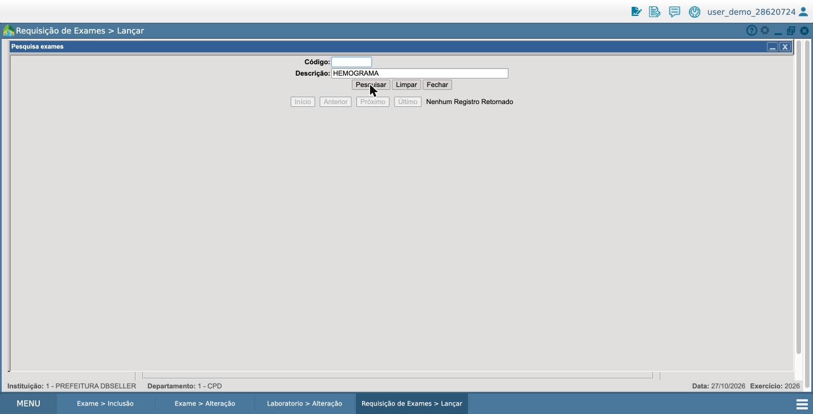 | H9 Reconhecer, diagnosticar e recuperar erros · H1 Visibilidade do status | Na Requisição de Exames, a busca por "HEMOGRAMA" retorna "Nenhum Registro Retornado", embora o exame esteja ATIVO, com procedimento e vinculado a setor. A tela não diz por que o exame não aparece (o filtro exige também laboratório ligado ao departamento do usuário). | **4** | Acontece toda vez que qualquer condição do exame ou do usuário falha · o servidor não tem como descobrir a causa pela interface e precisa abrir chamado ou conhecer o código · persiste até alguém corrigir o cadastro em outra tela. Bloqueia a tarefa-fim (atender o paciente). |
| P2 | 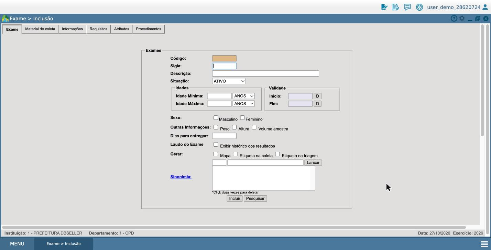 | H5 Prevenção de erros | No campo **Situação** da inclusão, o exame já vem como **ATIVO** por padrão, antes de ter material, procedimento e setor. O sistema permite "ativar" algo que ainda não pode ser usado. | **3** | Acontece em todo exame novo · o erro não é percebido no cadastro, só depois, em outra área · persistente, porque o padrão nunca muda. Não é 4 porque o exame pode ser corrigido depois. |
| P3 | 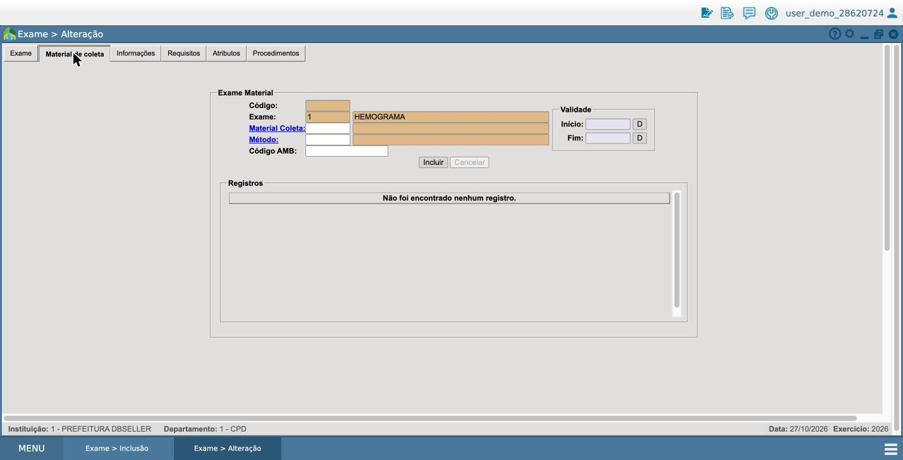 | H1 Visibilidade do status · H5 Prevenção de erros | O Hemograma está ATIVO e em uso, mas a aba **Material de coleta** mostra "Não foi encontrado nenhum registro". Nenhuma tela avisa que o cadastro está incompleto. | **3** | Frequente (o demo tem exames ativos com cadastro incompleto) · difícil de detectar, porque exige abrir aba por aba de cada exame · permanece até alguém conferir manualmente. |
| P4 | 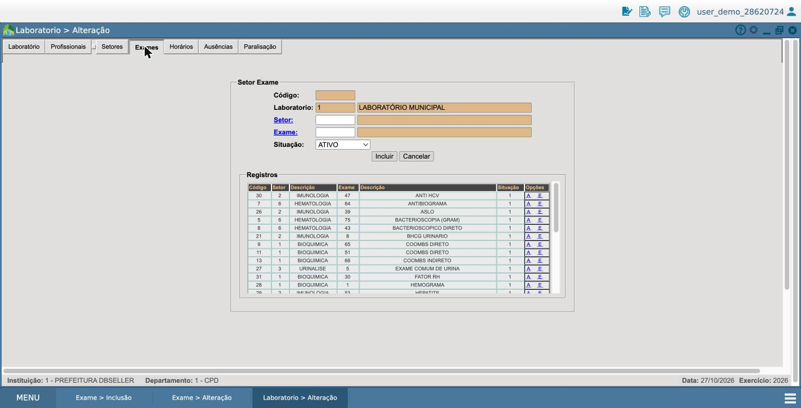 | H6 Reconhecer em vez de lembrar | O vínculo exame↔setor, condição para o exame aparecer na requisição, **não está no cadastro do exame**: fica em Cadastros › Laboratorio › aba Exames. O servidor precisa lembrar que esse passo existe e onde fica. | **3** | Acontece em todo exame novo · esquecer o passo faz o exame "sumir" sem aviso (ver P1) · persistente, porque é a estrutura do menu. |
| P5 | 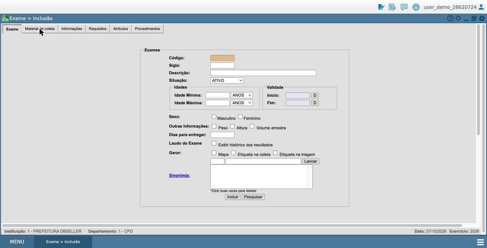 | H1 Visibilidade do status | Na inclusão, as abas Material de coleta, Informações, Requisitos, Atributos e Procedimentos têm aparência de clicáveis, mas não respondem antes de salvar a aba Exame, e não há mensagem explicando a ordem. | **2** | Acontece em toda inclusão · fácil de contornar depois que se aprende · uma vez aprendido, deixa de atrapalhar. |
| P6 | 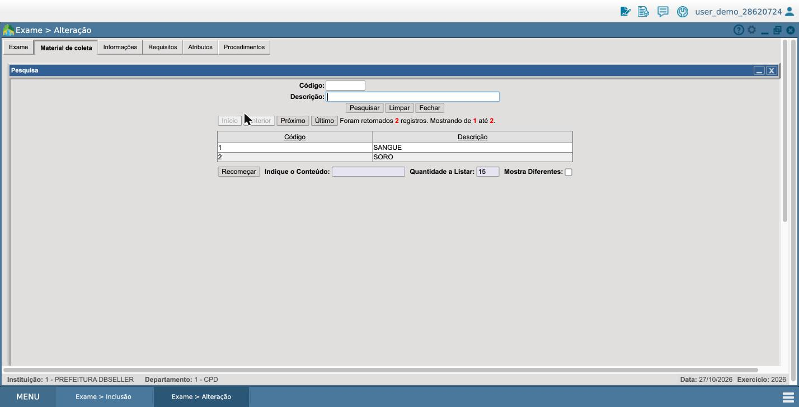 | H3 Controle e liberdade · H7 Flexibilidade e eficiência | A pesquisa de Material de coleta só lista o que existe (SANGUE, SORO). Se o material necessário não estiver cadastrado, não há opção de criar: o servidor precisa sair do exame, ir a outro menu e voltar. O mesmo padrão se repete para método, requisito, atributo e procedimento. | **3** | Acontece sempre que falta um auxiliar, comum em exames novos · contornar exige navegar por outro ramo do menu e retomar o exame · persistente, porque o padrão se repete em todos os auxiliares. |
| P7 | 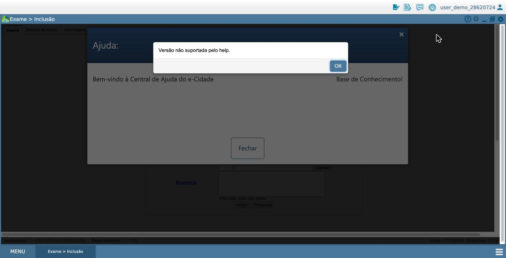 | H10 Ajuda e documentação | O botão de ajuda (?) › Ajuda do Sistema abre uma janela vazia com o aviso "Versão não suportada pelo help." Não há ajuda contextual para a tela. | **2** | Só aparece quando o servidor busca ajuda · sem ajuda, depende de colegas ou do suporte · persistente nesta versão. É 2 porque a ajuda não é o caminho principal da tarefa. |
| P8 | 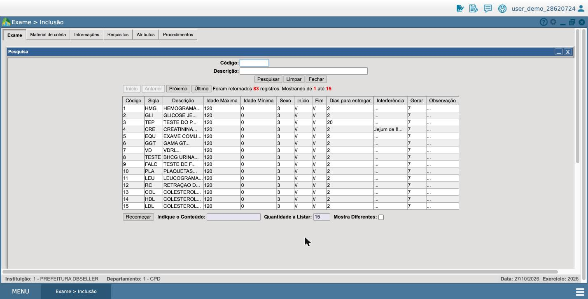 | H2 Correspondência com o mundo real · H8 Estética e design minimalista | A pesquisa de exames mostra códigos internos no lugar de significado (Sexo "3", Gerar "7", Início "//"), descrições cortadas ("HEMOGRAMA...", "COLESTEROL...") e nenhuma coluna de situação ou de prontidão. | **2** | Aparece em toda busca · dá para contornar abrindo o registro · persistente. Atrapalha distinguir exames parecidos (três "COLESTEROL..."). |
| P9 | 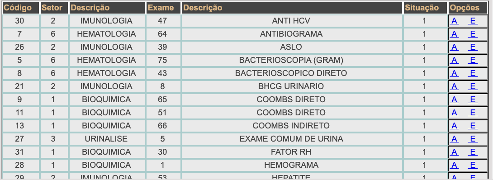 | H4 Consistência e padrões | O formulário usa "ATIVO" / "SIM", mas a tabela de registros mostra "1". As ações aparecem como "A" e "E" sem rótulo, e há duas colunas chamadas "Descrição" (setor e exame). O mesmo ocorre na aba Procedimentos (print 18). | **2** | Frequente nas telas de vínculo · o usuário experiente se acostuma, mas o novo erra ou hesita (o "E" exclui?) · persistente. |
| P10 |  | H6 Reconhecer em vez de lembrar · H3 Controle e liberdade | Em Sinonímia, dois campos sem rótulo, botão "Lancar" (sem cedilha) e exclusão por "*Click duas vezes para deletar", um gesto escondido e sem confirmação. | **2** | Aparece em toda inclusão · o rótulo ausente gera dúvida, e o duplo clique pode apagar sem querer · persistente. |
| P11 | 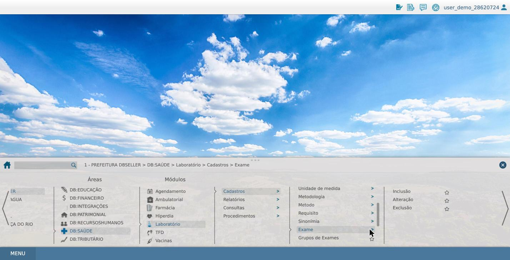 | H2 Correspondência com o mundo real · H7 Flexibilidade e eficiência | O menu organiza por estrutura do sistema, não pela tarefa: "Metodologia" e "Metodo" lado a lado; Inclusão/Alteração/Exclusão como itens separados; a requisição de exames fica a 7 níveis (Procedimentos › Recepção › Requisição de Exames › Lança, print 22). | **2** | Toda navegação passa pelo menu · os favoritos (estrela) amenizam · persistente. |
| P12 | 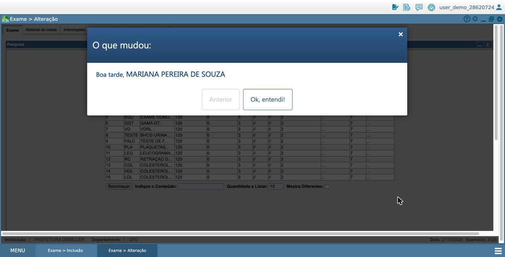 | H8 Estética e design minimalista | Ao abrir a tela de alteração, um modal "O que mudou:" interrompe o trabalho só com uma saudação, sem nenhuma mudança listada. | **1** | Aparece ao abrir telas · fecha-se com um clique · não impede a tarefa. |
| P13 | 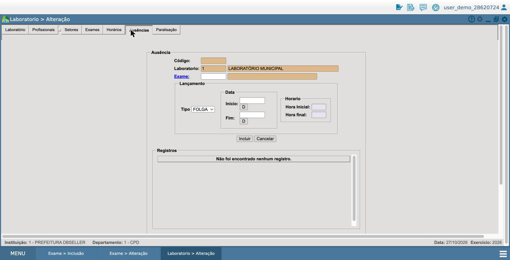 | H4 Consistência e padrões | No cadastro do Laboratório, as abas mudam de posição depois que o registro carrega (a aba "Usuarios externos" se recolhe). Um clique em "Exames" caiu em "Ausências". | **1** | Acontece ao carregar o registro · fácil de corrigir com um novo clique · cosmético, mas aumenta erro de clique. |

**Distribuição das severidades:** 4 → 1; 3 → 4; 2 → 6; e 1 → 2.

**Leitura.** Os problemas de severidade 3 e 4 (P1–P4, P6) não estão em uma tela só: aparecem porque a condição "o exame pode ser usado" depende de dados que ficam em telas e módulos diferentes (exame, auxiliares, setor do laboratório, procedimento e departamento do usuário) e nenhum ponto do sistema junta essas condições para mostrar ao servidor. Os de severidade 1 e 2 são de interface e se resolveriam com redesign das telas, sem mudar a arquitetura.

---

## 3. Blueprint as-is

A avaliação heurística mostra onde o servidor sofre, tela por tela, mas não explica por que os problemas mais graves aparecem juntos. O service blueprint ajuda nisso: ele organiza a mesma jornada em camadas, do que o servidor faz e vê até o que o sistema faz por trás e quais módulos do monolito são acionados em cada etapa. Assim fica visível onde a tarefa atravessa módulos, que é onde o monolito está mais acoplado, e é possível ligar cada ponto de falha a um problema da avaliação. O blueprint abaixo retrata a jornada como ela é hoje (as-is) e serve de base para futuras decisões.

**Arquivo no FigJam:** [Blueprint cadastro de exame (e-Cidade)](https://www.figma.com/board/oKgYfPOxCkoueY9JdVkwQN)

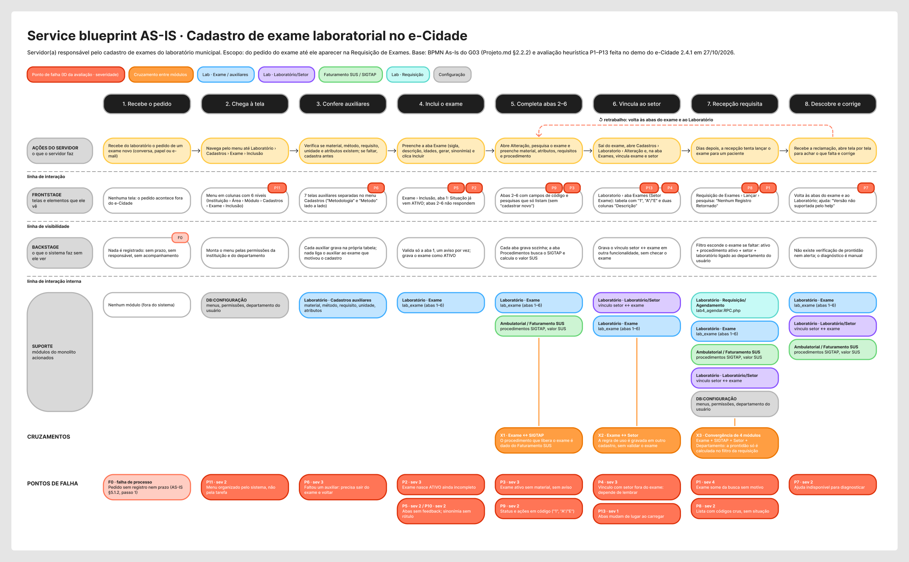

**Como foi montado.** As 8 etapas desdobram os 6 passos do BPMN As-Is do grupo (`Projeto.md` §2.2.2). O passo "Inclusão" foi separado em "inclui o exame" e "completa abas 2–6", e o "descobre e corrige" ficou explícito porque é onde o retrabalho acontece. As camadas seguem a anatomia vista em aula:

- **Ações do servidor:** o que ele faz.
- **Frontstage:** as telas reais avaliadas.
- **Backstage:** o que o sistema faz sem ele ver, conforme o código e o AS-IS do grupo.
- **Suporte:** cada post-it é um módulo do monolito.

**Módulos do monolito na camada de suporte**

Na camada de suporte, cada card representa um módulo do monolito que o sistema aciona para a etapa acontecer. A tabela abaixo reúne esses módulos e indica em quais etapas cada um aparece. Ela mostra que o cadastro de exame, embora pareça uma tarefa só do Laboratório, depende também da Configuração (departamento do usuário) e do Faturamento SUS (procedimentos SIGTAP).

| Módulo | Onde aparece na jornada |
|---|---|
| DB:CONFIGURAÇÃO (menus, permissões, departamento do usuário) | Etapas 2 e 7 |
| Laboratório · Cadastros auxiliares | Etapa 3 |
| Laboratório · Exame (`lab_exame`) | Etapas 4 a 8 |
| Ambulatorial / Faturamento SUS (procedimentos SIGTAP) | Etapas 5, 7 e 8 |
| Laboratório · Laboratório/Setor (vínculo setor ↔ exame) | Etapas 6, 7 e 8 |
| Laboratório · Requisição/Agendamento (`lab4_agendar.RPC.php`) | Etapa 7 |

**Cruzamentos entre módulos (laranja)**

Um cruzamento acontece quando uma mesma etapa precisa de dados ou regras de mais de um módulo. É ali que o monolito está mais acoplado e que uma mudança em um módulo pode quebrar a jornada em outro. No blueprint, eles estão marcados em laranja abaixo da camada de suporte.

| ID | Onde | O que mostra |
|---|---|---|
| X1 | Etapa 5 · Exame ↔ SIGTAP | O que libera o exame para uso (procedimento ativo) é dado do Faturamento SUS, não do Laboratório |
| X2 | Etapa 6 · Exame ↔ Setor | A regra de uso é gravada em outro cadastro, que não consulta o exame |
| X3 | Etapa 7 · Exame + SIGTAP + Setor + Departamento | As 4 condições só se encontram no filtro da requisição. É o ponto mais acoplado da jornada |

**Pontos de falha (vermelho) ligados à avaliação**

Os pontos de falha são os momentos em que a jornada pode dar errado para o servidor. Cada um usa o mesmo ID da avaliação heurística (P1–P13), então dá para voltar à tabela do tópico 2 e ver o print, a heurística e a severidade. No blueprint, eles aparecem como marcadores vermelhos na célula onde o problema acontece e como uma lista na última linha.

| Etapa | Camada | Pontos de falha |
|---|---|---|
| 1 | Backstage | F0, falha de processo sem tela (pedido sem registro) |
| 2 | Frontstage | P11 |
| 3 | Frontstage | P6 |
| 4 | Frontstage | P2, P5, P10 |
| 5 | Frontstage | P3, P9 |
| 6 | Frontstage | P4, P13 |
| 7 | Frontstage | P1, P8 |
| 8 | Frontstage | P7 |

**Leitura do blueprint**

Com os módulos, os cruzamentos e os pontos de falha no mesmo quadro, dá para cruzar essas informações e ver o que elas dizem juntas.

Os pontos de falha mais severos ficam exatamente nas etapas com cruzamento:

- P3 (sev 3) aparece no X1.
- P4 (sev 3) aparece no X2.
- P1 (sev 4) aparece no X3.

Já P2 (sev 3) e P6 (sev 3) aparecem dentro do próprio módulo Laboratório e preparam essas falhas, porque deixam o exame ativo e incompleto. A seta tracejada de retrabalho (etapa 8 → etapa 5) mostra o custo: a falha é criada nas etapas 4–6 e só é percebida na etapa 7, por outra pessoa e dias depois.

## 4. Blueprint to-be

**Arquivo no FigJam:** mesmo quadro, seção "Blueprint to-be".

**O que muda.** O to-be mostra a jornada depois do **primeiro corte**, não o sistema ideal. A regra "o exame pode ser agendado?" sai do filtro SQL da requisição e vira o **Serviço de Prontidão do Exame**, com dados próprios: estado, pendências, alertas e histórico. As telas do cadastro continuam no legado. Por isso a camada de suporte mistura componentes **novos** (verde) e **legado que convive** (azul, violeta e cinza).

**Base visual e camadas de informação.** Os elementos novos de tela (painel, faixa de checklist, selo de status e motivo na requisição) seguem o Padrão Digital de Governo (Design System gov.br). Eles são entregues como micro-frontend para conviver com as telas antigas. Cada elemento de frontstage está marcado com sua camada de informação:

- **1 Essencial:** painel de pendências, selo e motivo na requisição, alerta. É o que o servidor usa todo dia.
- **2 Frequente:** checklist com links diretos para a tela que resolve cada pendência.
- **3 Aprofundamento:** histórico e detalhes técnicos sob demanda.

O que é essencial foi decidido a partir do as-is. A tarefa mais frequente é saber se o exame está pronto, e a dor mais grave é ele sumir sem motivo (P1).

**Leitura.** As linhas finais do to-be mostram, por etapa, o que o corte resolve, o que continua igual e os riscos novos que ele cria. Essas três linhas são a base da proposta abaixo.

---

## 5. Proposta de corte: Serviço de Prontidão do Exame

**O que extrair.** A regra que decide se um exame pode ser requisitado. Hoje ela é só um filtro SQL em `lab4_agendar.RPC.php`, com quatro condições: exame ativo, procedimento SIGTAP ativo, vínculo com setor e laboratório ligado ao departamento do usuário. O serviço passa a ser dono dessa regra e de dados que hoje não existem: o **estado de prontidão** de cada exame, as pendências, os alertas e o histórico.

**Por que este pedaço primeiro.**

- **Blueprint.** O ponto mais acoplado da jornada é o cruzamento **X3**, onde Exame, SIGTAP, Setor e Departamento só se encontram nesse filtro, e X1 e X2 desembocam nele. O corte dá um dono à regra espalhada.
- **Avaliação.** O único problema de severidade 4, **P1** (exame ativo que "some" da requisição sem motivo), nasce ali. **P2, P3 e P4** (severidade 3) são o mesmo defeito por outro ângulo: o exame fica incompleto e ninguém é avisado. Com o serviço, o servidor vê tudo o que falta e a recepção vê o motivo.
- **Critérios da aula.** A **fronteira é clara**: uma regra, um ponto do código, linguagem própria. O **valor é visível**: o laboratório deixa de descobrir a falha pelo balcão e o suporte recebe menos chamados. Os dados que o serviço escreve são novos, sem migração nem disputa de escrita.
- **Strangler fig.** Construir com base própria e camada anticorrupção de leitura; desviar a busca da requisição, mantendo o filtro antigo como plano B; desligar o filtro quando estiver estável.

**Critério técnico contrário.** O corte falha em **pouca dependência**: o serviço lê dados que outros módulos continuam alterando (`lab_exame`, setor, SIGTAP com competência mensal, departamento). Como o legado não emite eventos, a reavaliação é periódica e pode haver minutos de inconsistência. Mudanças nessas tabelas afetam o serviço, e há risco de "monolito distribuído". Por esse critério, extrair o **Cadastro de Exame inteiro** teria fronteira de dados mais limpa. Aceito o custo porque a dependência é só de leitura e o cadastro inteiro seria um primeiro corte grande demais, mas atraso e divergência entre serviço e filtro precisam ser medidos durante a convivência.

**O que o corte não resolve.**

- Problemas de interface: abas sem feedback (P5), códigos crus (P9), sinonímia sem rótulo (P10), abas que mudam de lugar (P13), menu (P11) e ajuda (P7). Eles pedem redesign, não microsserviço.
- O cadastro espalhado: faltando um auxiliar, ainda é preciso sair do exame (P6), e o tempo de cadastro quase não muda.
- O pedido fora do sistema (F0) e a convivência de dois status ("ATIVO" no legado, "Pronto" no serviço).
- O tamanho do monolito: o ganho é de confiabilidade da jornada, não de redução do legado.

---

## 6. Desafio: Jobs to be Done

**Job statement.** *Quando o laboratório passa a oferecer um exame novo, ou um exame existente muda, eu quero deixá-lo pronto para ser agendado e ter certeza de que ele continua pronto, para que nenhum paciente deixe de ser atendido por causa de um cadastro incompleto.*

| Dimensão | O que a servidora quer |
|---|---|
| Funcional | Saber o que falta, em que tela resolver e quando terminou |
| Emocional | Confiar que, depois de cadastrado, o exame "não vai sumir" sem ela saber |
| Social | Não ser a pessoa culpada quando a recepção não encontra o exame no balcão |

**O que o JTBD acrescenta ao corte.** O job não é "preencher seis abas". É **ter certeza de que o exame pode ser usado**. Hoje o e-Cidade atende só a parte de registrar dados, e a certeza não tem dono, o que bate com o cruzamento X3. Por isso o primeiro serviço extraído é o que vende essa certeza (prontidão e alerta), e não o formulário. O formulário melhora o esforço, mas não o resultado que a servidora "contrata" o sistema para entregar.

---

## 7. Declaração de uso de IA

Usei o Claude (Anthropic), no modo Cowork, como assistente de pesquisa e documentação. Pelo volume de telas e imagens, pedi que ele navegasse no ambiente demo do e-Cidade (após meu login), capturasse os prints e os organizasse na pasta do trabalho e na tabela, cada um associado ao problema correspondente. Parti de uma lista preliminar de problemas feita por mim; o Claude a revisou, complementou e sugeriu a heurística e a severidade de cada item. Revisei, corrigi o que julguei necessário e consolidei a tabela final. Com base nas minhas anotações, ele estruturou os blueprints as-is e to-be no FigJam, que depois ajustei visualmente. Para a proposta de corte, ele apresentou três alternativas com prós e contras; a escolha do Serviço de Prontidão do Exame foi minha, e os textos foram redigidos em conjunto e revisados por mim. O objetivo foi tornar a análise mais robusta e manter a coerência entre as intormações.

---
## 8. Considerações finais

O **Ambiente avaliado:** foi o e-Cidade 2.4.1 no ambiente de demonstração (`ecidade.demo.dbseller.com.br`), onde nenhum registro foi criado ou alterado durante a avaliação.